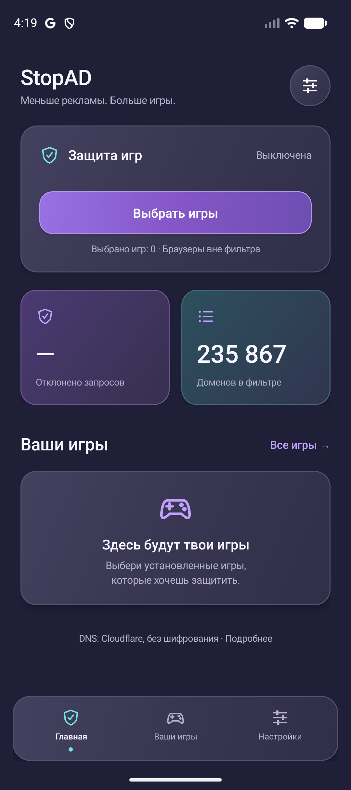

# StopAD

Android DNS filtering for selected games, using a local VPN. Browsers are excluded. Android 8.0 or newer is required.

[Download the latest APK](https://github.com/skensell201/stopad/releases/latest) · [User guide](docs/USER_GUIDE.md) · [Privacy](docs/PRIVACY.md) · [Development](docs/DEVELOPMENT.md) · [Changelog](CHANGELOG.md)

## Install

1. Open the [latest release](https://github.com/skensell201/stopad/releases/latest) on your Android device.
2. Download `StopAD-<version>.apk` from **Assets** and open it. Allow installation from that source if Android asks.
3. Select your games, start protection, and accept the Android VPN prompt.

See the [illustrated guide](docs/USER_GUIDE.md) for setup, controls, updates, and troubleshooting. The current app interface is in Russian; the guide provides English translations of the controls.



DNS filtering cannot remove every ad. Games using their own encrypted DNS, cached ads, or the same domains for ads and game content may bypass filtering. Rewarded videos may stop working. StopAD cannot run alongside another Android VPN. Allowed DNS queries are sent to Cloudflare without encryption; this is not a remote VPN or an anonymity service.

## Build

Install Android SDK 36 and JDK 17 or newer, then run:

```sh
./gradlew :app:assembleDebug :app:lintDebug
tools/check-core.sh
```

Output: `app/build/outputs/apk/debug/app-debug.apk`. Debug and official release builds use different signatures. See [Development](docs/DEVELOPMENT.md) for testing and signing.

Internal project decisions and work log are maintained in [Obsidian](obsidian://open?vault=ivan_vault&file=Projects%2Fstopad); all public setup instructions are in this repository.
