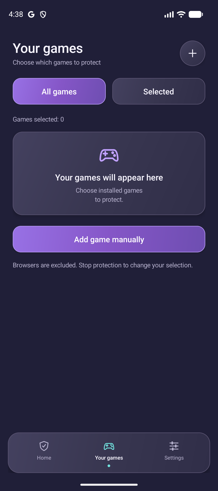
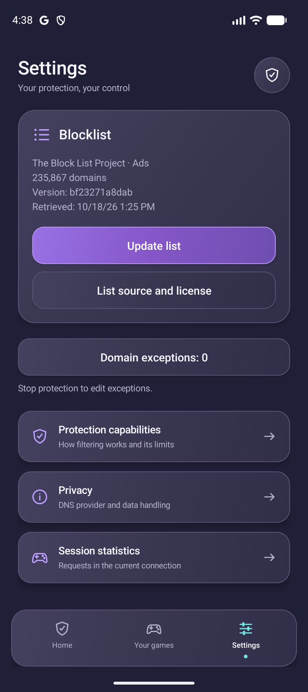

# StopAD user guide

StopAD filters DNS requests from games you select. It runs locally through Android's VPN API and does not filter browsers. It does not guarantee that all ads will disappear.

StopAD supports English and Russian. It follows the Android language, with English as the fallback for unsupported languages. On Android 13 or newer, you can choose English or Russian under Android Settings → Apps → StopAD → Language (the exact path varies by device). On Android 8–12, change the device language. Screenshots below show the English interface on an Android emulator, with no games selected; they do not show an active VPN or claim successful blocking.

## 1. Install the APK

1. Open the [latest release](https://github.com/skensell201/stopad/releases/latest).
2. Expand **Assets** and download `StopAD-<version>.apk`. Do not download the source-code ZIP to install the app.
3. Open the APK. If prompted, allow your browser or file manager to **install unknown apps**, then continue installation. You can revoke that permission afterward.
4. Open **StopAD**.

Optional integrity check: compare the APK's SHA-256 with `SHA256SUMS.txt` attached to the same release. On macOS run `shasum -a 256 StopAD-<version>.apk`; on Linux use `sha256sum`.

## 2. Select games

On Home, tap **Choose games**, or open **Your games** in the bottom navigation.

Select the checkbox on each game you want to filter. Use **All games** or **Selected** to filter the catalog. If an installed game is missing, use **Add game manually** and search by name or package. Browser apps are excluded, including from manual selection.

The emulator shown above has no eligible games, so it displays the empty state. Your installed games will appear here. Stop protection before changing the selection. StopAD will not establish a VPN with an empty selection.

## 3. Start protection

Return to **Home**.

1. If the app asks for DNS setup, open Android network settings and turn **Private DNS** off for this version of StopAD. Return to the app. StopAD does not change that setting automatically.
2. Tap **Start game protection**.
3. Accept Android's VPN connection request if you want to proceed. Declining leaves protection off.
4. Wait for **On**. **Off** means protection is stopped; **Waiting for network** means the VPN has no network connection. Only the On state with a network connection indicates that the engine is ready to process requests.
5. Open a selected game and use it normally.

The persistent VPN notification provides a stop action. You can also stop protection from Home with **Stop protection**. Protection does not automatically resume after a device reboot; open StopAD and start it again.

The blocked-request count measures DNS requests, not ads removed. A dash means no active session; the domain count is the size of the filtering list, not a measure of blocking success.

## 4. Update the list and manage exceptions

Open **Settings**.

- **Update list** downloads and validates the community list. If protection is already running, stop it and start it again to apply the new list.
- **List source and license** displays attribution.
- **Domain exceptions** lets you allow domains while protection is off. Enter one domain per line, without `https://` or paths. Its subdomains are also allowed, across all selected games. Saving an empty list removes the exceptions.
- **Protection capabilities** explains filtering limits.
- **Privacy** explains DNS handling.
- **Session statistics** displays blocked, forwarded, and failed DNS requests for the current session.

## 5. Update StopAD

Download the newer APK from [Releases](https://github.com/skensell201/stopad/releases) and install it over the existing official release. The official release signing key must match; normal updates preserve app settings.

A debug build from Android Studio has a different signature and cannot be updated with the official APK. If Android reports a signature conflict, back up your selections manually before uninstalling the debug build; uninstalling deletes its settings.

## Troubleshooting

| Problem | What to check |
| --- | --- |
| Protection will not start | Select at least one game, wait for the list to load, check connectivity, and disable Android Private DNS. Accept the VPN prompt. |
| Another VPN disconnects | Android supports one active VPN at a time. Choose which app to use. |
| Ads still appear | Confirm the game is selected and protection is On. Cached ads, built-in ads, shared content domains, and a game's own encrypted DNS can bypass filtering. |
| A game or rewarded video stops working | Stop protection and retry. If a specific blocked domain is known, add an exception. Rewarded video may require allowing its advertising service. |
| Browser ads are unchanged | Expected: browser filtering is outside this version's scope. |
| List update fails | Check the connection and try later. A failed update should leave the previous valid list available. |
| App installation fails | Check Android 8.0+, available storage, and whether an existing debug build causes a signing conflict. |

To report a problem, use [GitHub Issues](https://github.com/skensell201/stopad/issues). Include the StopAD version, device, Android version, game name/version, steps, and whether stopping protection resolves it. Do not post private data or credentials.
